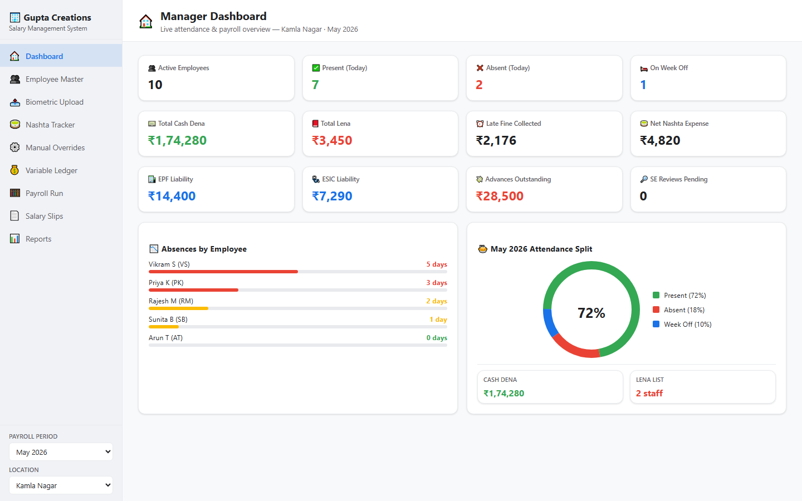
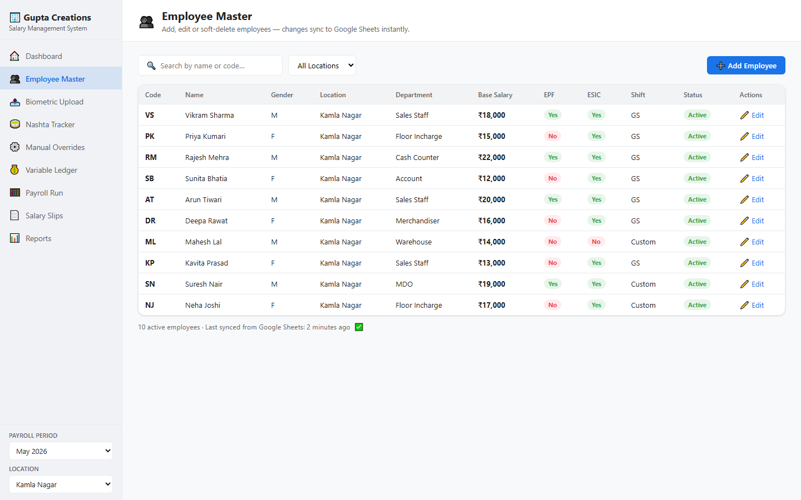
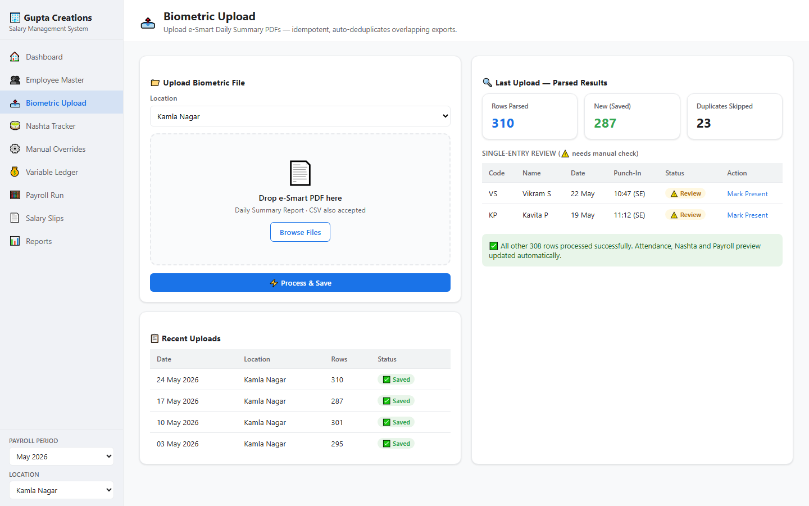
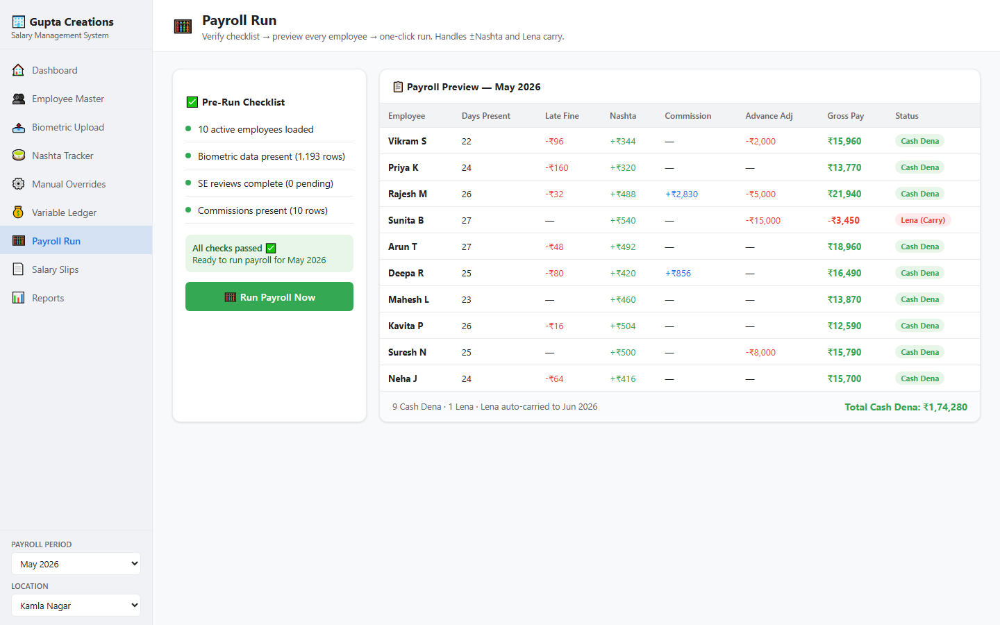
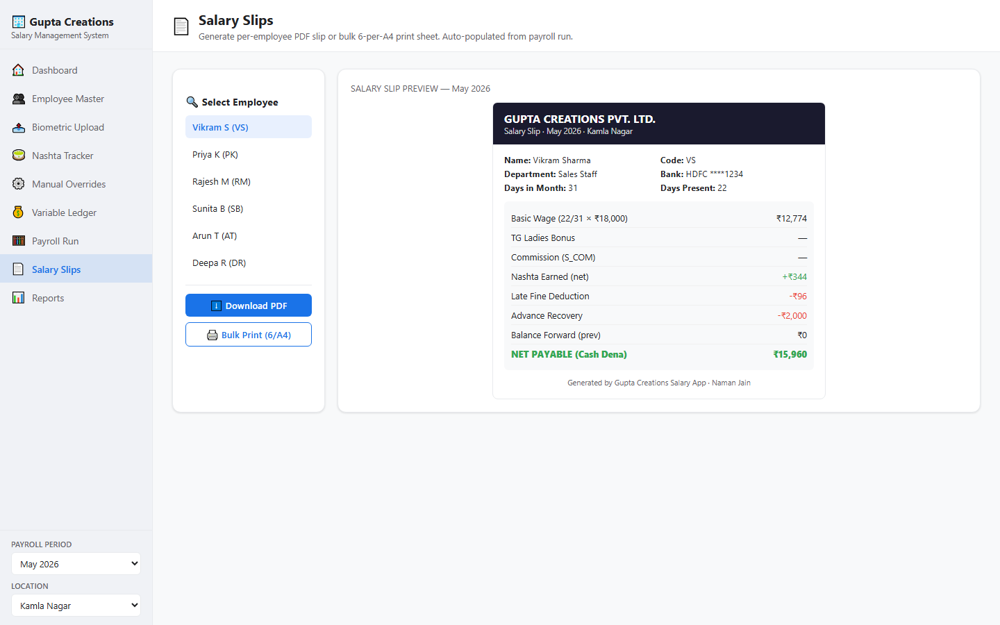
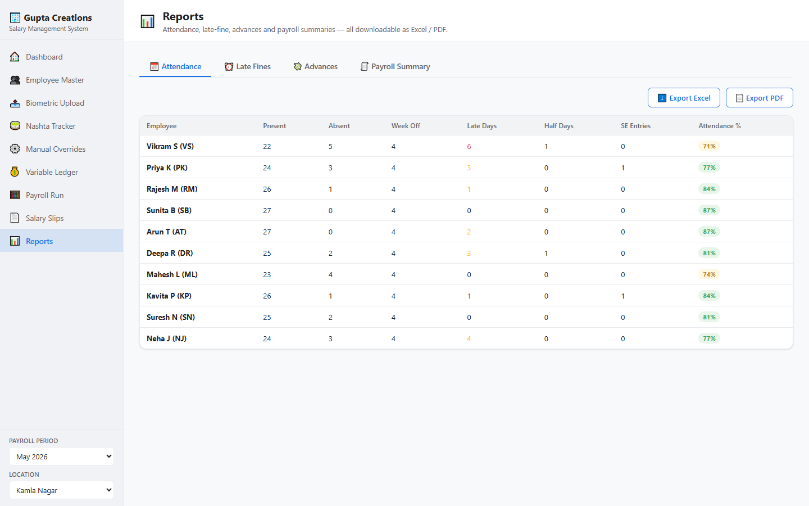
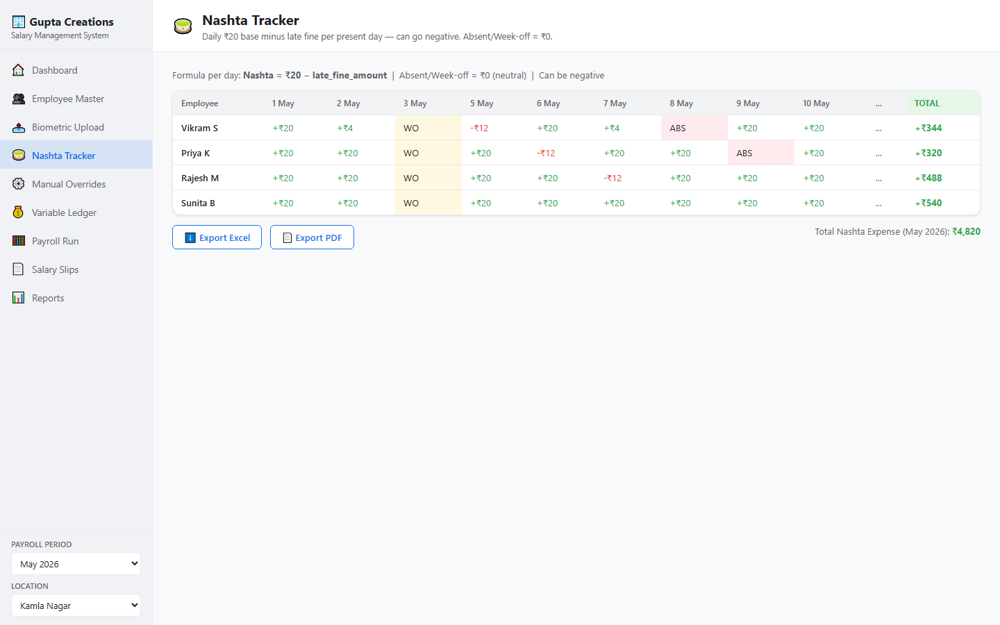
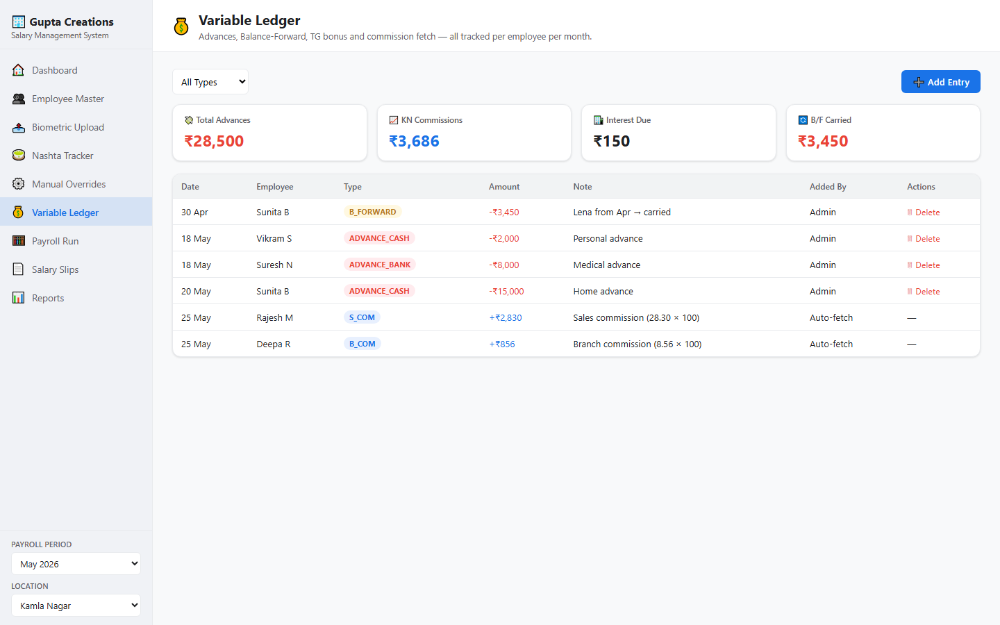

<div align="center">


<br/>

[](https://python.org)
[](https://streamlit.io)
[](https://sheets.google.com)
[](#-tests)
[](LICENSE)

**Internal HR & payroll engine for 100+ retail staff across 5 locations.**
Built with zero vendor lock-in - runs fully offline, or syncs live to Google Sheets.

[📺 Watch Demo Video](#-demo) · [📸 Screenshots](#-screenshots) · [🧪 Tests](#-tests)

</div>

---

## 📺 Demo

[](assets/demo_video.mp4)

> 60-second walkthrough: Dashboard → Payroll Run → Salary Slips - all features live.

---

## 📸 Screenshots

<table>
<tr>
<td width="50%">

<p align="center"><b>🏠 Dashboard</b><br/><sub>Live payroll KPIs, attendance split chart, today's absences</sub></p>
</td>
<td width="50%">

<p align="center"><b>👥 Employee Master</b><br/><sub>Editable grid, EPF/ESIC flags, Google Sheets auto-sync</sub></p>
</td>
</tr>
<tr>
<td width="50%">

<p align="center"><b>📤 Biometric Upload</b><br/><sub>Drop e-Smart PDF, auto-parse, dedup, flag SE entries</sub></p>
</td>
<td width="50%">

<p align="center"><b>🧮 Payroll Run</b><br/><sub>Pre-flight checklist → per-employee preview → one-click run</sub></p>
</td>
</tr>
<tr>
<td width="50%">

<p align="center"><b>📄 Salary Slips</b><br/><sub>PDF per employee or bulk 6-per-A4 print sheet</sub></p>
</td>
<td width="50%">

<p align="center"><b>📊 Reports</b><br/><sub>Attendance, late-fines, payroll summaries - Excel & PDF export</sub></p>
</td>
</tr>
<tr>
<td width="50%">

<p align="center"><b>🍵 Nashta Tracker</b><br/><sub>Daily ₹20 − late-fine per employee, monthly totals</sub></p>
</td>
<td width="50%">

<p align="center"><b>💰 Variable Ledger</b><br/><sub>Advances, commissions, B/F, interest - all audited</sub></p>
</td>
</tr>
</table>

---

## ✨ Feature Overview

### 9 Pages - Everything HR Needs

| Page | What it handles |
|------|----------------|
| 🏠 **Dashboard** | Live KPIs: Cash Dena, Lena, late fines, nashta, EPF/ESIC, advances outstanding. Attendance donut + absences-by-employee bar chart. |
| 👥 **Employee Master** | Add / edit / soft-delete employees. Stores salary, EPF, ESIC, shift type, bank details. Editable grid with inline save. |
| 📤 **Biometric Upload** | Upload e-Smart "Daily Summary Report" PDFs. Idempotent - overlapping exports are de-duplicated automatically. Flags single-entry (SE) rows for manager review. |
| 🍵 **Nashta Tracker** | Day-by-day grid: ₹20 base minus that day's late fine. Can go negative. Absent / week-off = ₹0 (neutral). Exportable as Excel or PDF. |
| ⚙️ **Manual Overrides** | Week-off day change, single/double absent, long leave - all stamped with admin name for audit trail. |
| 💰 **Variable Ledger** | Cash advances, bank advances, balance-forward from last month, interest on advances, TG bonus, and auto-fetched KN commissions. |
| 🧮 **Payroll Run** | Pre-flight checklist (biometric loaded? SE reviewed? commissions present?) → per-employee preview table → one-click run. Auto-carries Lena to next month. |
| 📄 **Salary Slips** | Generates ReportLab PDF per employee. Bulk print mode fits 6 slips on one A4 sheet for cost-efficient printing. |
| 📊 **Reports** | Attendance breakdown, late-fine analysis, advance ledger, payroll summary - all downloadable as Excel or PDF. |

---

## 🔄 Portable - Runs Anywhere, No Server Required

This is the core design philosophy: **the app works identically with or without internet or Google credentials.**

```
┌──────────────────────────────────────────────────────┐
│                sheets_sync.py                        │
│                                                      │
│  credentials present?                                │
│    YES ──▶ GSpreadBackend (live Google Sheets)       │
│    NO  ──▶ LocalBackend   (CSV files in local_db/)  │
└──────────────────────────────────────────────────────┘
```

| Scenario | Works? | Notes |
|----------|--------|-------|
| **No internet, no credentials** | ✅ | Reads/writes `local_db/*.csv` |
| **Google Sheets connected** | ✅ | Auto-syncs every read/write |
| **Laptop → different laptop** | ✅ | Copy the folder, done |
| **Streamlit Cloud deploy** | ✅ | Add secrets → Google Sheets mode auto-activates |
| **Offline demo / training** | ✅ | Built-in demo dataset (10 employees, one month) |

**Zero code changes needed to switch modes.** The same `app.py` runs in all environments.

---

## 💡 Business Logic (Verified Against Paper Slips)

The engine applies the shop's real rules: daily rate = salary ÷ days in month, late-fine slabs, a daily nashta allowance net of fines, double cut for a Sunday absence, commissions from the sales sheet, advances with interest, and carry-forward (Lena) balances. Every rule was checked line by line against 7 real handwritten slips until each matched to the rupee.

---

## 🧪 Tests

112 automated tests (pytest), including 7 real handwritten salary slips reproduced to the rupee. Tests run in the private source repo.

---

## 🔐 Source

The source code is private. For a demo or a version for your business: [pixlforgestudio.in](https://pixlforgestudio.in).

---

## ⚙️ Tech Stack

| Layer | Tech | Why |
|-------|------|-----|
| UI | Streamlit 1.35+ | Rapid multi-page app, native data_editor, no JS |
| Data backend | Google Sheets via gspread 6 + fallback local CSV | Portable - zero DB setup |
| PDF generation | ReportLab 4.2 | Precise A4 slip layout, 6-per-page print |
| Spreadsheet export | openpyxl + pandas | Excel reports with formatting |
| Charts | Plotly 5.20 | Interactive attendance and payroll charts |
| Auth | Streamlit session state | Simple login gate, manager-only access |
| Tests | pytest | 112 unit + integration tests |

---

## 🔒 Security Notes

- `secrets/service_account.json` is **gitignored** - never committed
- `local_db/*.csv` with real employee data are **gitignored**
- Login is manager/admin only - no employee-facing portal
- All payroll overrides are stamped with admin username + timestamp

---

## 👤 Built By

**Naman Jain** - [PixlForge Studio](https://pixlforgestudio.in)

AI automation tools and custom business software for Indian SMBs.

---

<div align="center">
<sub>Built for a 5-location Delhi retail chain · 100+ staff · 112 tests passing · 7 real slips matched to the rupee</sub>
</div>
